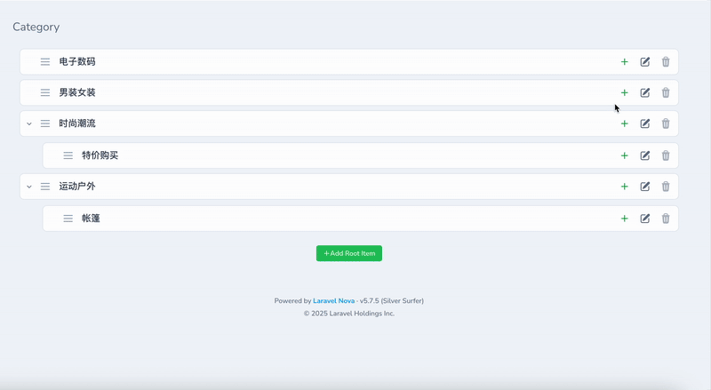

<p align="center"></p>

[中文版本](docs/README_zh.md)

# Laravel Nova Nestable

A Laravel Nova extension package for managing nested/hierarchical data structures. This package provides an intuitive drag-and-drop interface to manage data with parent-child relationships, such as menus, categories, organizational structures, etc.

## Features

- 🌳 **Hierarchical Data Management** - Support for unlimited nested data structures
- 🎯 **Drag & Drop Sorting** - Intuitive drag-and-drop interface for sorting and hierarchy adjustment
- 🔧 **Highly Configurable** - Flexible field configuration and display options
- 🎨 **Beautiful Interface** - Modern UI design with collapse/expand support
- ⚡ **Real-time Updates** - Drag operations are saved to database in real-time
- 🔒 **Permission Control** - Integrated with Nova's permission system
- 📱 **Responsive Design** - Mobile-friendly operations
- 🔍 **Compact Mode** - Toggle between normal and compact view modes for better space utilization

## Installation

Install the package via Composer:

```bash
composer config repositories.fayne/laravel-nova-nestable '{"type": "git", "url": "git@github.com:Fayne/laravel-nova-nestable.git"}' --file composer.json
composer require fayne/laravel-nova-nestable
```

## Screenshot



Publish the configuration file:

```bash
php artisan vendor:publish --provider="Fayne\NovaNestable\NovaNestableServiceProvider" --tag="config"
```

## Configuration

### 1. Model Configuration

First, ensure your model implements the `ShouldNestable` interface and uses the `Nestable` trait:

```php
<?php

namespace App\Models;

use Illuminate\Database\Eloquent\Model;
use Fayne\NovaNestable\Contracts\ShouldNestable;
use Fayne\NovaNestable\Traits\Nestable;

class Category extends Model implements ShouldNestable
{
    use Nestable;

    // Define parent-child relationships
    public function parent()
    {
        return $this->belongsTo(Category::class, 'parent_id');
    }

    public function children()
    {
        return $this->hasMany(Category::class, 'parent_id')->orderBy('weight');
    }

    // Optional: customize weight field name
    public function getWeightFieldName(): string
    {
        return 'weight'; // default value
    }
}
```

### 2. Database Migration

Example migration:

```php
Schema::create('categories', function (Blueprint $table) {
    $table->id();
    $table->string('name');
    $table->string('slug')->unique();
    $table->unsignedBigInteger('parent_id')->nullable();
    $table->integer('weight')->default(0);
    $table->boolean('is_active')->default(true);
    $table->timestamps();

    $table->foreign('parent_id')->references('id')->on('categories')->onDelete('cascade');
    $table->index(['parent_id', 'weight']);
});
```

### 3. Nova Resource Configuration

- Field configuration for Menu type:

```php
<?php

namespace App\Nova;

use Laravel\Nova\Resource;
use Fayne\NovaNestable\Nova\Fields\NestableField;

class MenuResource extends Resource
{
    public static $model = \App\Models\Menu::class;

    public function fields(Request $request)
    {
        return [
            // ...
            NestableField::make(__('Menu Items'), 'menuItems')
                    ->onlyOnDetail(),
            // ...
        ];
    }
}
```

- Config configuration for Category type

Configure mapping relationships in `config/nova-nestable.php`:

```php
<?php

return [
    'mapping' => [
        'categories' => [
            'modelClass' => \App\Models\Category::class,
            'maxDepth' => 5,
            'toggleField' => 'is_active',
            'titleField' => 'name',
            'subtitleField' => 'slug',
            'canToggle' => true,
            'canDelete' => true,
            'novaParameters' => [
                'resourceUri' => 'categories',
                'viaResource' => null,
            ],
        ],
    ],
];
```

## Usage

### Basic Usage

1. **View Hierarchy**: In the Nova resource detail page, click the "Manage Hierarchy" field
2. **Drag & Drop Sorting**: Directly drag items to change order and hierarchy relationships
3. **Toggle Status**: Click toggle buttons to enable/disable items
4. **Delete Items**: Click delete buttons to remove items (if allowed)
5. **Compact Mode**: Click the compact mode toggle button (📏) in the top-right corner to switch between normal and compact view modes for better space utilization

### Advanced Configuration

#### Custom Field Configuration

```php
NestableField::make('Manage Categories', \App\Models\Category::class)
    ->titleField('name')                    // Main title field
    ->subtitleField('description')          // Subtitle field
    ->toggleField('is_published')           // Status toggle field
    ->canToggle(true)                      // Allow status toggle
    ->canDelete(false)                     // Disable deletion
    ->collapsedAsDefault(true)             // Collapsed by default
    ->subtitleIsUrl(true)                  // Subtitle as URL
    ->nestableRootMethod('customRootMethod') // Custom root method
    ->novaParameters([                     // Nova parameters
        'resourceUri' => 'category-resources',
        'viaResource' => 'category-resources',
    ]);
```

#### Custom Root Method

If you need to customize the root node retrieval method:

```php
class Category extends Model implements ShouldNestable
{
    use Nestable;

    // Custom root node retrieval method
    public static function customRootMethod(): Collection
    {
        return static::query()
            ->where('parent_id', null)
            ->where('type', 'main')
            ->orderBy('weight')
            ->get();
    }

    public static function getRootNestableItemsMethodName(): string
    {
        return 'customRootMethod';
    }
}
```

### Event Listening

The package triggers the `NovaNestableOrderingUpdated` event, which you can listen to:

```php
// Register in EventServiceProvider
protected $listen = [
    \Fayne\NovaNestable\Events\NovaNestableOrderingUpdated::class => [
        \App\Listeners\HandleNestableOrderingUpdate::class,
    ],
];

// Listener example
class HandleNestableOrderingUpdate
{
    public function handle(NovaNestableOrderingUpdated $event)
    {
        // $event->entity - Entity class or key
        // $event->requestId - Request ID
        
        // Execute custom logic, such as clearing cache
        Cache::forget('categories_tree');
    }
}
```

## Console Commands

The package provides convenient Artisan commands to quickly generate models and Nova resources with nestable functionality:

### nestable:model

Generate a model with nestable functionality:

```bash
php artisan nestable:model {name} [options]
```

**Options:**
- `-m, --migration` - Create a new migration file for the model
- `-f, --factory` - Create a new factory for the model
- `-s, --seed` - Create a new seeder for the model
- `-c, --controller` - Create a new controller for the model
- `-r, --resource` - Create a new form request classes for the model
- `-p, --policy` - Create a new policy for the model
- `--nova-resource` - Create a new Nova resource for the model

**Examples:**

```bash
# Generate a basic nestable model
php artisan nestable:model Category

# Generate model with migration and Nova resource
php artisan nestable:model Category --migration --nova-resource
```

### nestable:resource

Generate a Nova resource with nestable field configuration:

```bash
php artisan nestable:resource {name} [options]
```

**Options:**
- `--model=` - The model class (defaults to same name as resource)

**Examples:**

```bash
# Generate a Nova resource for Category model
php artisan nestable:resource CategoryResource

# Generate a Nova resource without specific name
php artisan nestable:resource
```

### Generated Files

The commands will generate the following files with proper nestable configuration:

1. **Model** - Implements `ShouldNestable` interface and uses `Nestable` trait
2. **Migration** - Includes `parent_id` and `weight` fields with proper indexes
3. **Nova Resource** - Pre-configured with `NestableField`
4. **Configuration** - Automatically adds mapping to `config/nova-nestable.php`

## API Endpoints

The package provides the following API endpoints:

- `POST /nova-vendor/nestable/items` - Get nestable items
- `POST /nova-vendor/nestable/items/sorting` - Save sorting results
- `PATCH /nova-vendor/nestable/items/{itemId}` - Update single item
- `DELETE /nova-vendor/nestable/items/{itemId}` - Delete single item

## Fake Data

```shell
php artisan db:seed --class="Fayne\NovaNestable\Database\Seeders\CategorySeeder"
```

## Contributing

1. Create a feature branch
2. Make your changes
3. Add tests for new features
4. Ensure all tests pass
5. Submit a pull request

## License

This package is proprietary software licensed under [Proprietary License](./LICENSE.md).
