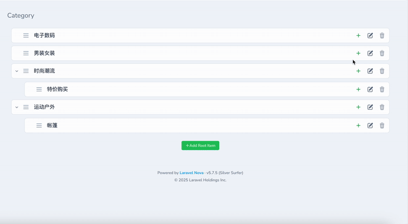

<p align="center"></p>


# Laravel Nova Nestable

一个用于管理嵌套/层次化数据结构的 Laravel Nova 扩展包。该包提供了直观的拖拽界面来管理具有父子关系的数据，如菜单、分类、组织架构等。

## 功能特性

- 🌳 **层次化数据管理** - 支持无限层级的嵌套数据结构
- 🎯 **拖拽排序** - 直观的拖拽界面进行排序和层级调整
- 🔧 **高度可配置** - 灵活的字段配置和显示选项
- 🎨 **美观的界面** - 现代化的 UI 设计，支持折叠/展开
- ⚡ **实时更新** - 拖拽操作实时保存到数据库
- 🔒 **权限控制** - 集成 Nova 的权限系统
- 📱 **响应式设计** - 支持移动端操作
- 🔍 **紧凑模式** - 在正常视图和紧凑视图模式之间切换，更好地利用空间

## 安装

通过 Composer 安装包：

```bash
composer config repositories.fayne/laravel-nova-nestable '{"type": "git", "url": "git@github.com:Fayne/laravel-nova-nestable.git"}' --file composer.json
composer require fayne/laravel-nova-nestable
```

## 截屏



发布配置文件：

```bash
php artisan vendor:publish --provider="Fayne\NovaNestable\NovaNestableServiceProvider" --tag="config"
```

## 配置

### 1. 模型配置

首先，确保你的模型实现了 `ShouldNestable` 接口并使用 `Nestable` trait：

```php
<?php

namespace App\Models;

use Illuminate\Database\Eloquent\Model;
use Fayne\NovaNestable\Contracts\ShouldNestable;
use Fayne\NovaNestable\Traits\Nestable;

class Category extends Model implements ShouldNestable
{
    use Nestable;

    // 定义父子关系
    public function parent()
    {
        return $this->belongsTo(Category::class, 'parent_id');
    }

    public function children()
    {
        return $this->hasMany(Category::class, 'parent_id')->orderBy('weight');
    }

    // 可选：自定义权重字段名
    public function getWeightFieldName(): string
    {
        return 'weight'; // 默认值
    }
}
```

### 2. 数据库迁移

举例：

```php
Schema::create('categories', function (Blueprint $table) {
    $table->id();
    $table->string('name');
    $table->string('slug')->unique();
    $table->unsignedBigInteger('parent_id')->nullable();
    $table->integer('weight')->default(0);
    $table->boolean('is_active')->default(true);
    $table->timestamps();

    $table->foreign('parent_id')->references('id')->on('categories')->onDelete('cascade');
    $table->index(['parent_id', 'weight']);
});
```

### 3. Nova 资源配置

- Field 配置，适用于Menu类型：

```php
<?php

namespace App\Nova;

use Laravel\Nova\Resource;
use Fayne\NovaNestable\Nova\Fields\NestableField;

class MenuResource extends Resource
{
    public static $model = \App\Models\Menu::class;

    public function fields(Request $request)
    {
        return [
            // ...
            NestableField::make(__('Menu Items'), 'menuItems')
                    ->onlyOnDetail(),
            // ...
        ];
    }
}
```

- config配置，适用于Category类型

在 `config/nova-nestable.php` 中配置映射关系：

```php
<?php

return [
    'mapping' => [
        'categories' => [
            'modelClass' => \App\Models\Category::class,
            'maxDepth' => 5,
            'toggleField' => 'is_active',
            'titleField' => 'name',
            'subtitleField' => 'slug',
            'canToggle' => true,
            'canDelete' => true,
            'novaParameters' => [
                'resourceUri' => 'categories',
                'viaResource' => null,
            ],
        ],
    ],
];
```

## 使用方法

### 基本用法

1. **查看层次结构**：在 Nova 资源的详情页面，点击 "Manage Hierarchy" 字段
2. **拖拽排序**：直接拖拽项目来改变顺序和层级关系
3. **切换状态**：点击切换按钮来启用/禁用项目
4. **删除项目**：点击删除按钮来移除项目（如果允许）
5. **紧凑模式**：点击右上角的紧凑模式切换按钮（📏）在正常视图和紧凑视图模式之间切换，更好地利用空间

### 高级配置

#### 自定义字段配置

```php
NestableField::make('Manage Categories', \App\Models\Category::class)
    ->titleField('name')                    // 主标题字段
    ->subtitleField('description')          // 副标题字段
    ->toggleField('is_published')           // 状态切换字段
    ->canToggle(true)                      // 允许状态切换
    ->canDelete(false)                     // 禁止删除
    ->collapsedAsDefault(true)             // 默认折叠
    ->subtitleIsUrl(true)                  // 副标题作为链接
    ->nestableRootMethod('customRootMethod') // 自定义根节点方法
    ->novaParameters([                     // Nova 参数
        'resourceUri' => 'category-resources',
        'viaResource' => 'category-resources',
    ]);
```

#### 自定义根节点方法

如果需要自定义获取根节点的方法：

```php
class Category extends Model implements ShouldNestable
{
    use Nestable;

    // 自定义根节点获取方法
    public static function customRootMethod(): Collection
    {
        return static::query()
            ->where('parent_id', null)
            ->where('type', 'main')
            ->orderBy('weight')
            ->get();
    }

    public static function getRootNestableItemsMethodName(): string
    {
        return 'customRootMethod';
    }
}
```

### 事件监听

包会触发 `NovaNestableOrderingUpdated` 事件，你可以监听此事件：

```php
// 在 EventServiceProvider 中注册
protected $listen = [
    \Fayne\NovaNestable\Events\NovaNestableOrderingUpdated::class => [
        \App\Listeners\HandleNestableOrderingUpdate::class,
    ],
];

// 监听器示例
class HandleNestableOrderingUpdate
{
    public function handle(NovaNestableOrderingUpdated $event)
    {
        // $event->entity - 实体类或键
        // $event->requestId - 请求ID
        
        // 执行自定义逻辑，如清除缓存等
        Cache::forget('categories_tree');
    }
}
```

## 控制台命令

该包提供了便捷的 Artisan 命令来快速生成具有嵌套功能的模型和 Nova 资源：

### nestable:model

生成具有嵌套功能的模型：

```bash
php artisan nestable:model {name} [options]
```

**选项：**
- `-m, --migration` - 为模型创建新的迁移文件
- `-f, --factory` - 为模型创建新的工厂类
- `-s, --seed` - 为模型创建新的种子类
- `-c, --controller` - 为模型创建新的控制器
- `-r, --resource` - 为模型创建新的表单请求类
- `-p, --policy` - 为模型创建新的策略类
- `--nova-resource` - 为模型创建新的 Nova 资源

**示例：**

```bash
# 生成基本的嵌套模型
php artisan nestable:model Category

# 生成带迁移和 Nova 资源的模型
php artisan nestable:model Category --migration --nova-resource

```

### nestable:resource

生成带有嵌套字段配置的 Nova 资源：

```bash
php artisan nestable:resource {name} [options]
```

**选项：**
- `--model=` - 模型类名（默认与资源同名）

**示例：**

```bash
# 为 Category 模型生成 Nova 资源
php artisan nestable:resource CategoryResource

# 手动输入Nova Resource 类名
php artisan nestable:resource
```

### 生成的文件

这些命令将生成以下具有正确嵌套配置的文件：

1. **模型** - 实现 `ShouldNestable` 接口并使用 `Nestable` trait
2. **迁移** - 包含 `parent_id` 和 `weight` 字段及适当的索引
3. **Nova 资源** - 预配置了 `NestableField`
4. **配置** - 自动添加映射到 `config/nova-nestable.php`

## API 端点

包提供了以下 API 端点：

- `POST /nova-vendor/nestable/items` - 获取嵌套项目
- `POST /nova-vendor/nestable/items/sorting` - 保存排序结果
- `PATCH /nova-vendor/nestable/items/{itemId}` - 更新单个项目
- `DELETE /nova-vendor/nestable/items/{itemId}` - 删除单个项目

## Fake Data

```shell
php artisan db:seed --class="Fayne\NovaNestable\Database\Seeders\CategorySeeder"
```

## 贡献

1. 创建功能分支
2. 进行更改
3. 为新功能添加测试
4. 确保所有测试通过
5. 提交拉取请求

## 许可证

此包是根据 [专有许可证](../LICENSE.md) 许可的软件。
